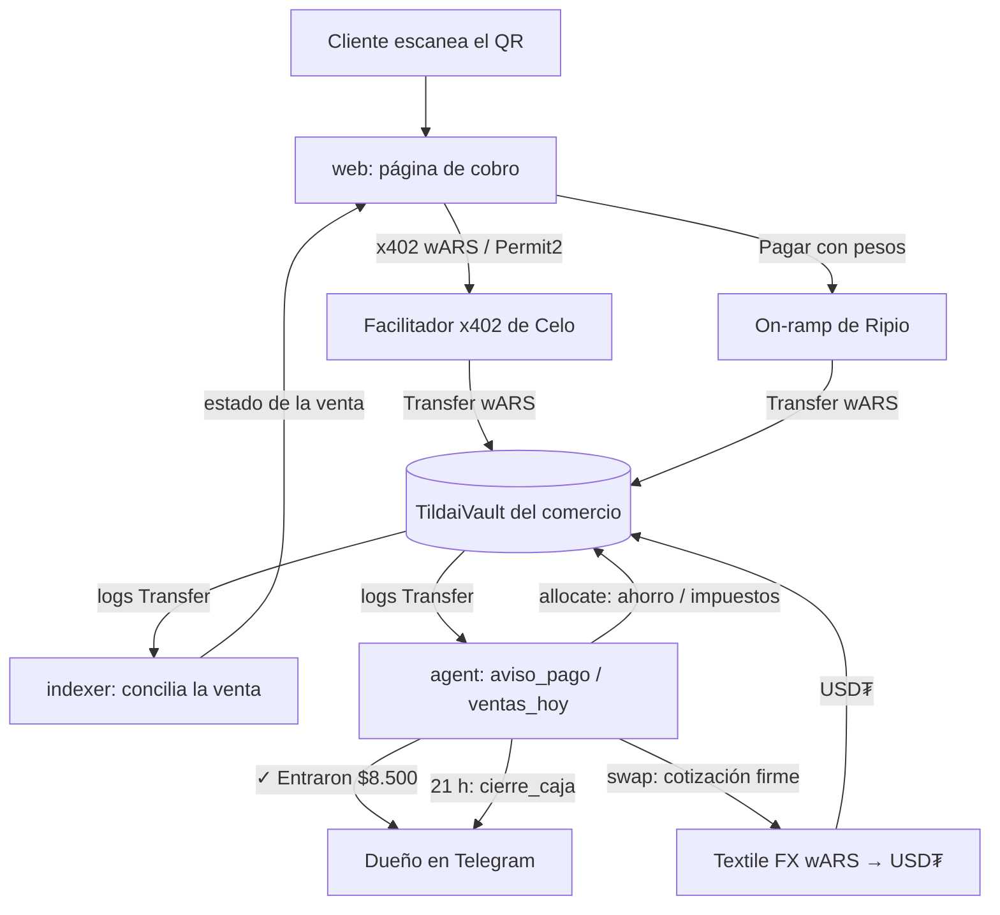

# Tildai

**Cada cobro, tildado.**

Tildai es un agente de caja para comercios de barrio en Argentina. Cobra en **wARS** (el peso argentino onchain de Ripio) sobre **Celo**, avisa las ventas por Telegram, hace el cierre de caja diario, aparta ahorro e impuestos y puede pasar el excedente a dólares (USD₮) en **Textile FX**.

Proyecto para la hackathon **Agents on Open Rails** (Loops House × Celo). Track principal: *Stable Agents: LatAm (Ripio × Celo)*. Secundario: *Open Corridors: Textile FX*.

> **Estado (19/10/2026):** contratos, agente, indexer, página de cobro y módulo FX escritos y con tests. Desplegado en **Celo Sepolia** con tokens de prueba. **Mainnet: pendiente** (falta fondear la wallet del agente con USD₮ para gas). Todavía no hay comercios reales usándolo.

## El problema

El comercio chico argentino (kiosco, verdulería, peluquería) cobra con posnet o billeteras pagando comisión, espera la acreditación, lleva la caja a mano en un cuaderno, no ahorra porque la plata se mezcla con la del día y pierde poder adquisitivo con la inflación mientras los pesos quedan quietos.

## Qué hace Tildai

- **Cobra en pesos onchain.** El dueño escribe "cobrame 8.500" en Telegram y recibe un link con QR. El cliente paga en wARS desde la página de cobro sin pagar gas (x402 con Permit2) o, si no tiene cripto, con pesos por el on-ramp de Ripio directo al vault.
- **Avisa los pagos.** Una venta queda "cobrada" solo cuando hay un `Transfer` de wARS confirmado hacia el vault.
- **Cierra la caja** todos los días a las 21 h (hora argentina): total, cantidad de ventas, ticket promedio y comparación con el mismo día de la semana anterior.
- **Aparta ahorro e impuestos** después del cierre, según los porcentajes del dueño. La plata no sale del vault: pasa a saldos protegidos.
- **Dolariza** wARS a USD₮ en Textile FX cuando el dueño lo pide, con precio máximo y tope por operación fijados onchain.
- **Retira** a la wallet del dueño y le da el link de off-ramp de Ripio para pasarlo a su cuenta.

## Arquitectura

| Carpeta | Qué es |
|---|---|
| [`contracts/`](contracts/) | Solidity (Foundry). `TildaiVault`: la caja de cada comercio, con saldos operativo / ahorro / impuestos, tope diario, precio máximo del dólar y swap con Textile. `TildaiFactory`: crea un vault por comercio y lleva el registro `isVault` |
| [`agent/`](agent/) | Agente en [eve](https://eve.dev) con canal de Telegram. Tools: `crear_vault`, `crear_cobro`, `aviso_pago`, `ventas_hoy`, `apartar`, `retirar`, `dolarizar`. Schedule `cierre_caja` (21 h AR). Todas las tx salen por `agentClients()` con attribution tag |
| [`indexer/`](indexer/) | Servicio HTTP que descubre vaults por `VaultCreated`, indexa `Transfer` de wARS hacia ellos, concilia ventas y expone `/sales`, `/payments` y `/events` |
| [`web/`](web/) | Next.js: página de cobro con QR, pago x402 en wARS (Permit2), botón "Pagar con pesos" (Ripio) y estado del pago consultando al indexer |
| [`fx/`](fx/) | Cliente de Textile FX: cotización preview, cotización firme (RFQ) y P&L de la dolarización leyendo los eventos `Swapped` del vault |

Hoy el agente lee los `Transfer` directo de la cadena y el aviso sale cuando el dueño pregunta ("¿me pagaron?"). El indexer ya expone `/events` con cursor para avisos push, pero el agente todavía no lo consume (ver limitaciones).

## Por qué encaja en cada track

| Track | Cómo encaja | Qué está hecho |
|---|---|---|
| **Stable Agents: LatAm (Ripio × Celo)** | Agente de comercio que cobra, concilia, ahorra y liquida en wARS: lo que pide el track ("merchant agents that invoice, collect, and reconcile"). Usa los ramps de Ripio para entrar y salir de pesos, x402 para que el cliente no pague gas y fee abstraction para que el agente pague gas en USD₮ | Vault + factory, alta por `/start`, cobro x402 y Ripio, conciliación, cierre y apartado. Probado en Sepolia; mainnet pendiente |
| **Open Corridors: Textile FX** | Tesorería para comercios de barrio: el vault es el taker del RFQ de Textile y dolariza wARS → USD₮ dentro de límites onchain (precio máximo, tope por swap, tope diario). P&L calculado desde los eventos `Swapped` | Cliente de la API de Textile (preview y cotización firme RFQ, con API key de partner) y `vault.swap` probado en un fork de mainnet. Sin swaps reales todavía |

## Modelo de seguridad

- **El agente no custodia fondos.** La plata está en el `TildaiVault` de cada comercio. El dueño es una dirección propia (no la del agente).
- **Destinos permitidos.** El agente solo puede: apartar dentro del vault (`allocate`), retirar wARS operativo a la **wallet de retiro del dueño** (`withdraw`) y hacer swaps con los contratos de Textile habilitados (`swap`). Los USD₮ quedan en el vault; solo el dueño los saca. Un token o el propio vault no pueden registrarse como destino de Textile.
- **Tope diario** (retiros + dolarización, día en hora argentina), **precio máximo** del dólar y **tope por swap**, chequeados en el contrato. El swap solo confía en los saldos antes/después: si entra menos USD₮ que el mínimo o la tasa es peor que el máximo, revierte.
- **Ahorro e impuestos protegidos.** El agente no los retira; solo puede dolarizarlos si el dueño lo habilitó por separado.
- **El dueño retira todo** (`ownerWithdraw`, cualquier token, en cualquier momento), cambia o pausa al agente, cambia la wallet de retiro y los límites. El agente solo puede volver los límites más estrictos o pausarse.
- **Idempotencia.** Cada operación del agente lleva un `opId` y el vault rechaza los repetidos.
- **El LLM no decide montos.** Interpreta pedidos y redacta mensajes; lo que mueve plata es código determinístico. Si un mensaje de Telegram parece una clave privada o una frase semilla, no llega al modelo y se le pide al usuario que lo borre.

## Cómo correr cada parte

Requisitos: Node 24+ y [Foundry](https://book.getfoundry.sh) para los contratos. Cada carpeta tiene su `package.json` (no hay workspace). Los tests usan datos y clientes falsos; los que tocan la red se pueden saltear como se indica.

| Parte | Instalar | Tests | Correr |
|---|---|---|---|
| `contracts/` | `npm install` | `forge test` (fork de mainnet: `FORK=1 forge test --match-contract Fork`, en bash) | `forge build` (lo necesitan los scripts de deploy) |
| `agent/` | `npm install` | `npm test` (`TILDAI_SKIP_NETWORK=1` saltea la lectura de Sepolia) | `npm run dev` (TUI de eve; detalle del webhook de Telegram en [`agent/README.md`](agent/README.md)) |
| `indexer/` | `npm install` | `npm test` (`TILDAI_OFFLINE=1` saltea el test contra Sepolia) | `npm start` |
| `web/` | `npm install` | `npm test` y `npm run build` | `npm run dev` |
| `fx/` | `npm install` | `npm test` | se usa como librería desde `agent/` |

Resultado al 19/10: contratos 22, agent 60 (+1 salteado), indexer 48 (+1 salteado), fx 28, web 37; todos en verde.

Scripts del agente (desde `agent/`, después de `forge build` en `contracts/`):

- `npm run wallet`: genera la wallet del agente y guarda la clave en `.env`; imprime solo la dirección.
- `node scripts/deploy-sepolia.ts`: despliega factory + tokens de prueba en Sepolia y verifica el attribution tag de cada tx. Guarda en `contracts/deployments/celo-sepolia.json`.
- `node scripts/register-8004.ts celoSepolia|celo`: registra la identidad ERC-8004 desde la wallet del agente.
- `node scripts/deploy-mainnet.ts`: dry run (simula, no envía). Con `CONFIRM_MAINNET=1` despliega. Igual para `register-8004.ts celo`.

## Variables de entorno

Solo nombres. Los valores van en un `.env` por carpeta, que está en `.gitignore`.

| Carpeta | Variables |
|---|---|
| `agent/` | `AGENT_PRIVATE_KEY`, `TEXTILE_API_KEY`, `TELEGRAM_BOT_TOKEN`, `TELEGRAM_WEBHOOK_SECRET_TOKEN`, `TELEGRAM_BOT_USERNAME`, `TILDAI_OWNER_CHAT_ID`, `TILDAI_NETWORK` (`celo` o `celoSepolia`), `TILDAI_FACTORY`, `TILDAI_FROM_BLOCK`, `TILDAI_VAULT`, `TILDAI_REGISTRY`, `TILDAI_PAY_BASE_URL`, `TILDAI_SAVINGS_PCT`, `TILDAI_TAXES_PCT`; solo scripts: `CONFIRM_MAINNET`. Credenciales del modelo: `/login` en la TUI de eve |
| `indexer/` | `TILDAI_INDEXER_TOKEN` (mín. 16 caracteres), `TILDAI_STORE_PATH`, `TILDAI_NETWORK` (`celo` o `celo-sepolia`), `TILDAI_FACTORY`, `TILDAI_FROM_BLOCK` (obligatorios en mainnet), `TILDAI_WARS`, `RPC_URL`, `TILDAI_POLL_SECONDS`, `TILDAI_PORT`, `TILDAI_HOST` |
| `web/` | `NEXT_PUBLIC_BASE_URL`, `TILDAI_FACTORY`, `TILDAI_CHAIN_ID` (`42220` o `11142220`), `TILDAI_RPC_URL`, `TILDAI_DEMO`, `X402_API_KEY`, `X402_FACILITATOR_URL`, `TILDAI_INDEXER_URL`, `TILDAI_INDEXER_TOKEN` (ver [`web/.env.example`](web/.env.example)) |
| `fx/` | `TEXTILE_API_KEY` |

## Datos de la entrega

| Dato | Celo Sepolia (11142220) | Celo mainnet (42220) |
|---|---|---|
| Wallet del agente | `0x2B7c25FedB6d09e149fedc1ffE35529b1cab1f65` | `0x2B7c25FedB6d09e149fedc1ffE35529b1cab1f65` (misma wallet; sin fondear) |
| ERC-8004 | agentId **626** | **pendiente** (registry `0x8004A169FB4a3325136EB29fA0ceB6D2e539a432`) |
| `TildaiFactory` | `0x963c9f2b54d765d74d8e1bd13f801b515ed44413` | **pendiente** |
| Vault de prueba (smoke test) | `0x498450FE2b46F6b380857b2DE20Df7D52D17F18B` | **pendiente** |
| wARS | `0x7fd80E16929Eac12833c6e214B00eFd43AD20E49` (token de prueba propio) | `0x0dc4f92879b7670e5f4e4e6e3c801d229129d90d` (Ripio) |
| USD₮ | `0xa765dB30C3079D9ED7c3072832254D0E18f8F721` (token de prueba propio) | `0x48065fbBE25f71C9282ddf5e1cD6D6A887483D5e` |

Fuente de Sepolia: [`contracts/deployments/celo-sepolia.json`](contracts/deployments/celo-sepolia.json).

- **Attribution tag (ERC-8021):** `celo_c376b2fd04bc`, agregado en el cliente de wallet del agente (`agent/src/chain.ts`) a todas sus tx. Los scripts de deploy y registro verifican el tag de cada tx con `verifyTx`.
- **Wallets PayTo (x402):** los `TildaiVault` de cada comercio. El cliente paga directo al vault; los pagos x402 no llevan nuestro tag. Mainnet: **pendiente** (no hay vaults desplegados).
- **Gas sponsoreado (x402):** no lo pagamos nosotros. La ruta `/api/pay` declara la extensión `eip2612GasSponsoring` (`GAS_SPONSORING` en `web/lib/x402.ts`): el cliente firma fuera de la cadena el permit EIP-2612 (que habilita a Permit2 a mover su wARS) y la autorización de Permit2, y el **facilitador x402 de Celo** (`api.x402.celo.org`) envía la liquidación onchain y paga el gas, incluido el del permit. El cliente no necesita CELO ni hacer un `approve`. Según la documentación del facilitador, la API key trae settlements gratis y después cobra gas + comisión a quien la usa. Las tx propias del agente (alta del vault, apartados, retiros, swaps) las paga el agente: en mainnet en USD₮ por fee abstraction, en Sepolia en CELO de prueba.
- **Usuarios y métricas:** **pendiente**. No hay comercios ni clientes reales todavía.
- **Transacciones en mainnet:** **pendiente**.

## Limitaciones honestas

- **Mainnet pendiente de fondeo.** Falta cargar USD₮ en la wallet del agente para registrar ERC-8004, desplegar la factory y crear vaults. También falta la `X402_API_KEY` del facilitador de mainnet. El cobro x402 solo funciona con `TILDAI_CHAIN_ID=42220`, así que en Sepolia no se probó un pago x402 de punta a punta.
- **Textile tiene cotización pero volumen casi nulo** en wARS/USD₮ (y `bid` en 0: no hay comprador para volver de USD₮ a wARS). El swap se probó en un fork de mainnet; no hay swaps reales.
- **Agente e indexer no están conectados.** El agente no registra las ventas en el indexer ni consume `/events`: concilia leyendo los logs de la cadena y avisa cuando el dueño pregunta, no por push.
- **El cierre de caja solo corre para el vault del dueño configurado** (`TILDAI_OWNER_CHAT_ID` + `TILDAI_VAULT`), no para cada comercio dado de alta por `/start`.
- **Telegram abierto al `/start`** si no se define `TILDAI_OWNER_CHAT_ID`: falta rate limit o allowlist antes de abrirlo en mainnet.

Atajos conocidos (comentarios `shortcut:` en el código):

- `agent/src/sales.ts`: ventas en memoria, se pierden al reiniciar. Un `Transfer` no lleva memo: se asocia a la venta pendiente más vieja con el mismo monto creada antes del pago.
- `agent/src/vaultOps.ts`: el registro de cada operación con plata vive en memoria y va al log; falta persistirlo y avisarlo por Telegram.
- `agent/src/alta.ts`: el registro chat → vault es un JSON local por proceso.
- `agent/src/chainVault.ts`: lee los logs del vault en tramos en cada consulta, sin cursor.
- `agent/src/cierreApartado.ts`: si el cierre muere entre ahorro e impuestos, el reintento puede apartar menos de impuestos.
- `contracts/src/TildaiFactory.sol`: el agente es fijo en la factory; si se filtra su clave hay que redesplegarla y cada dueño llama `setAgent` en su vault.
- `indexer/src/main.ts`: sin TLS ni rate limit; escucha solo en localhost por defecto.
- `indexer/src/indexer.ts`: una tx x402 equivocada deja la venta pendiente para siempre, sin vencimiento ni alerta.
- `fx/pnl.ts`: valúa USD₮ al precio de venta del preview de Textile porque no hay `bid` real.
- `agent/scripts/register-8004.ts`: el agentURI es un `data:` URI onchain; pasar a una URL web cuando exista.

## Documentación

| Archivo | Contenido |
|---|---|
| [`idea.md`](idea.md) | Documento maestro: idea, arquitectura, flujos, plan y riesgos |
| [`GLOSSARY.md`](GLOSSARY.md) | Vocabulario (vault, cobro, cierre de caja, apartado) |
| [`docs/adr/`](docs/adr/) | Decisiones de arquitectura (0001: el vault dolariza directo con Textile) |
| [`docs/textile-fx.md`](docs/textile-fx.md) | Notas de la integración con Textile FX |
| [`contexto.md`](contexto.md) | Información de la hackathon |
| [`AGENTS.md`](AGENTS.md) | Reglas para agentes de código |
